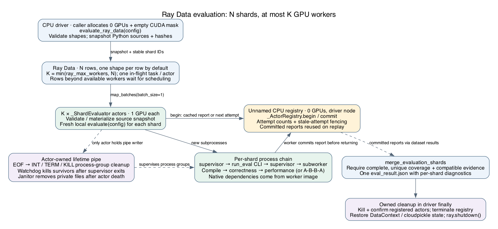
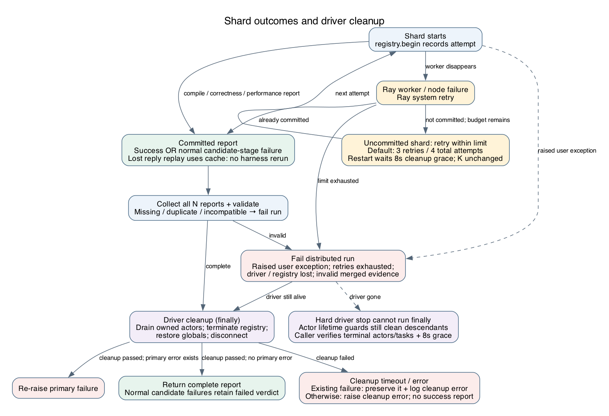

# Ray Data execution and failure handling

Ray distribution is opt-in (`distribution="ray_data"`). The caller provides an
existing Ray cluster, compatible native dependencies, and a GPU worker budget.
Shapes become dataset rows, not independent Ray jobs. With N shapes and a worker
limit K, all N rows are retained while at most K single-GPU actors run them.
Local evaluation remains the default and is also the rollback path.



## Shard outcomes

A normal candidate compile, correctness, or performance failure is a reportable
outcome, not an infrastructure retry. Raised user exceptions fail the distributed
run. Ray worker/node failures may replay a map task; the registry checks each
shard before running its harness, reuses committed results, caps attempts, and
rejects stale completions. Default three retries means four total attempts.
There is no durable checkpoint or whole-driver recovery.



When cleanup itself fails, an existing evaluation or initialization exception
remains the primary exception and a separate `[atrex-ray-cleanup]` diagnostic is
written to stderr. Without an earlier failure, cleanup failure raises instead of
returning a successful report. A hard driver kill cannot execute Python `finally`;
actor/process lifetime guards and caller-side terminal-state checks remain needed.
This is process lifecycle management, not isolation from hostile candidate code.

## Mapping the diagrams to code

| Diagram component | Implementation |
|---|---|
| Driver setup, dataset, bounded pool, cleanup scope | [`evaluate_ray_data`](../src/atrex_bench/ray_data.py) |
| Per-shard attempts, cached results, stale-attempt fencing | [`_ActorRegistry.begin` / `commit`](../src/atrex_bench/ray_data.py) |
| Source bootstrap and fresh local evaluation | [`_ShardEvaluator.__init__` / `__call__`](../src/atrex_bench/ray_data.py) |
| Actor termination confirmation | [`_drain_actors`, `_terminate_registry`, `_wait_actor_terminated`](../src/atrex_bench/ray_data.py) |
| Lifetime pipe, signal propagation and descendant watchdog | [`supervised_popen` / `main`](../src/atrex_bench/_process_guard.py) |
| Local CLI and isolated subworker stages | [`run_eval.py`](../src/atrex_bench/cli/run_eval.py) |
| Complete coverage and compatible report validation | [`merge_evaluation_shards`](../src/atrex_bench/shards.py) |

The registry is unnamed and passed by actor handle; sharing a Ray namespace does
not require claiming a fixed actor name. Independent drivers still have separate
registries. This does not add support for concurrent evaluations mutating the
same Python process's Ray/DataContext state.

Workers replace **all** inherited `PYTHONPATH` entries, including image-provided
entries, with transported Python source paths. Ray cannot identify which entries
refer to driver-local directories. Native dependencies must be installed in the
worker interpreter's `site-packages`; arbitrary driver packages are not shipped.
The source snapshot does not make incompatible GPU images interchangeable.

See the [CLI/runtime contract](run_eval_cli_contract.md#automatic-ray-data-distribution)
for configuration, report fields, ABBA behavior and cleanup limits. Diagram sources
are [execution.dot](diagrams/ray-data-execution.dot) and
[failures.dot](diagrams/ray-data-failures.dot). Regenerate with Graphviz, for example:

```bash
dot -Tpng -Gdpi=110 docs/diagrams/ray-data-execution.dot -o docs/diagrams/ray-data-execution.png
dot -Tpng -Gdpi=110 docs/diagrams/ray-data-failures.dot -o docs/diagrams/ray-data-failures.png
```
